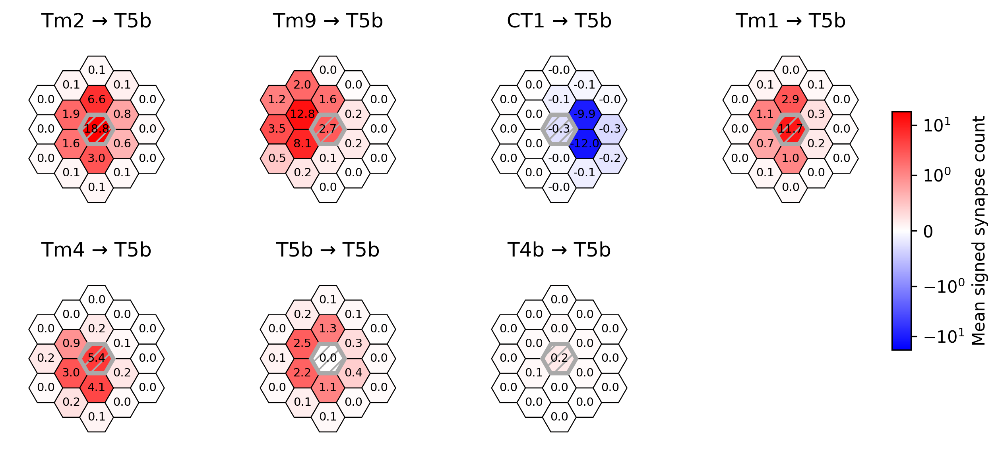

# Male CNS Connectome: Variability of T4/T5 Input Kernels

How variable are the spatial inputs to the motion pathway, and does that variability covary across input types?

This repository builds a **columnar connectome** of the male CNS optic lobe and uses it to measure
**spatial input kernels** onto T4/T5 neurons: for each input type, the number of synapses it provides as a
function of hexagonal column offset `(dp, dq)` relative to the T4/T5 cell's own column. It then
quantifies how those kernels vary from cell to cell.



## Questions

1. **How variable are the inputs to the motion pathway?** (`notebooks/2_variability/`)
   - Which input types and which T4/T5 subtypes vary the most?
   - Is the variation in overall strength, in spatial shape, or both?
2. **Does the variability covary across inputs?** (`notebooks/3_covariation/`)
   - When input A's spatial pattern changes from one cell to the next, does input B's change with it?
3. **What priors does this give for modeling?** (planned)
   - A mean spatial kernel per input → T4/T5 pair.
   - How far a cell is allowed to deviate from the mean, in strength and in shape.

## Analysis flow

The notebooks are numbered in the order they should be read and run. Each stage reads the outputs of the stage
before it.

```text
connectome_data/malecns/         raw male CNS v0.9 optic tables + column pins (not tracked)
        │
        ▼  0_build_connectome
connectome_data/processed/       intermediate tables (not tracked)
        │
        ▼
results/connectome/              final columnar node + edge tables (tracked)
        │
        ▼  1_kernels → 2_variability → 3_covariation
results/figures/
```

### 0 · Build the columnar connectome (`notebooks/0_build_connectome/`)

The male CNS release gives column identities (`hex_1`, `hex_2`) for only some optic-lobe types. These notebooks
use those types as anchors to infer columns for T4/T5 and CT1.

| Notebook | What it does | Writes |
|---|---|---|
| `01_T4_T5_cols` | Assigns each T4/T5 cell a home column by matching it to its columnar inputs (linear-sum assignment), using either raw or normalized input counts | `processed/columnar_nodes`, `processed/T4_T5_home_columns`, `processed/T4_T5_home_columns_norm` |
| `02_ct1_edgelist_full` | Assigns CT1 synapses to columns using the nearest column pin (Nern et al. 2025) | `processed/ct1_edgelist_full` |
| `03_ct1_edgelist_columnar` | Splits CT1 into column-level units, adds column offsets, drops non-columnar CT1 edges | `processed/ct1_columnar_edges` |
| `04_optic_columnar_connectome` | Merges everything into one annotated edge list with pre/post type, columns, offsets, neurotransmitter sign and synapse count (edges with ≤ 4 synapses are dropped) | `results/connectome/{nodes,edgelist}_OL_columnar*.feather` |

The final tables come in two versions:

- `*_OL_columnar.feather`: T4/T5 columns assigned from raw input counts.
- `*_OL_columnar_T4T5norm.feather`: T4/T5 columns assigned from normalized input counts. **This is the default
  for all downstream analyses.**

### 1 · Spatial kernels (`notebooks/1_kernels/`)

| Notebook | What it does |
|---|---|
| `11_visualize_kernels` | Computes mean and per-cell kernels for each input type onto one T4/T5 subtype. Shows example cells, kernels laid out on the eye, the grid of all strong inputs, and the summed signed receptive field |

Offset convention: `(dp, dq)` is where the postsynaptic cell sits relative to the input, so `(-dp, -dq)` is where
the input sits relative to the postsynaptic cell.

### 2 · Variability (`notebooks/2_variability/`)

| Notebook | What it does |
|---|---|
| `22_kernel_variability_basic_stats_v2` | Per-cell summary statistics (total strength, spread, cosine similarity to the mean kernel) for single input → T4/T5 pairs |
| `23_kernel_variability_all_inputs` | The same measures applied to all strong inputs onto one subtype at once. Similarity of each cell to the canonical kernel, and how that compares across input types |

### 3 · Covariation (`notebooks/3_covariation/`)

| Notebook | What it does |
|---|---|
| `PCA_SVD_single_pair` | PCA/SVD over cells for one input → T4/T5 pair. Main modes of kernel variation and whether they track position on the eye |
| `PCA_SVD_ALL_inputs` | PCA over cells using all strong inputs concatenated. PC loadings per input, regression of PCs on eye position, k-means clusters of cells |
| `CCA` | Canonical correlation between the kernels of two input types across cells, with loadings and a permutation null. *TODO: record correlation coefficients for all pairs.* |

## Code (`utils/`)

The notebooks import shared helpers from `utils`, which is installed as a package (see Install).

| Module | Contents |
|---|---|
| `io.py` | Local/GCS readers (`read_feather_gcs`, `construct_path`, …) and **`load_columnar_connectome(norm=True)`**, the entry point every analysis notebook uses to load the final tables |
| `spatial_RF.py` | `compute_kernel`, `all_input_kernels`: zero-filled mean and per-cell spatial kernels (with special handling for CT1 column units) |
| `plotting.py` | Hex geometry (`pq_to_xy`, `hex_offsets`, `hex_distance`) and kernel plots (`plot_spatial_kernel_hex`, `receptive_fields_grid`, `plot_kernels_on_eye`, …) |
| `type_pair_stats.py` | `stats_ctype_pair`, `summarize_vector`: per-cell variability statistics for input → T4/T5 pairs |

Typical start of an analysis notebook:

```python
from utils.io import load_columnar_connectome
from utils.spatial_RF import compute_kernel

edges, nodes_df = load_columnar_connectome(norm=True)
mean_kernel, per_cell = compute_kernel(edges, pre_type="Mi1", post_type="T4b", radius=2)
```

## Repository layout

```text
.
├── notebooks/
│   ├── 0_build_connectome/   # raw data → columnar connectome tables
│   ├── 1_kernels/            # spatial input kernels
│   ├── 2_variability/        # how variable are kernels across cells
│   └── 3_covariation/        # do kernels of different inputs covary (PCA, CCA)
├── utils/                    # shared helpers (installed package)
├── results/
│   ├── connectome/           # final node/edge tables (Feather, tracked)
│   └── figures/              # exported figures
├── connectome_data/          # raw + intermediate data (gitignored, ~2 GB)
│   ├── malecns/              # male CNS v0.9 optic meta, edges, synapses, pin_data/
│   └── processed/            # outputs of 01–03
├── pyproject.toml
└── README.md
```

## Data

`connectome_data/` is not tracked. To rebuild the connectome from scratch, put these files in
`connectome_data/malecns/`:

- `malecns_09_meta.feather`
- `malecns_optic_malecns_09_optic_simple_edgelist.feather`
- `malecns_optic_malecns_09_optic_synapses.feather`
- `pin_data/{ME,LO,LOP}_pindata.csv`: column pins from Nern et al. (2025), *Nature*

The final tables in `results/connectome/` are tracked. Stages 1–3 run without the raw data.

## Install

```bash
conda create -n connectome python=3.11 pip -y
conda activate connectome
python -m pip install -e ".[analysis,notebooks]"
python -m pip install scikit-learn        # used by the variability/covariation notebooks
python -m ipykernel install --user --name connectome --display-name "Python (connectome)"
```

Run the commands from the repository root. Then pick the **Python (connectome)** kernel in Jupyter or VS Code.
